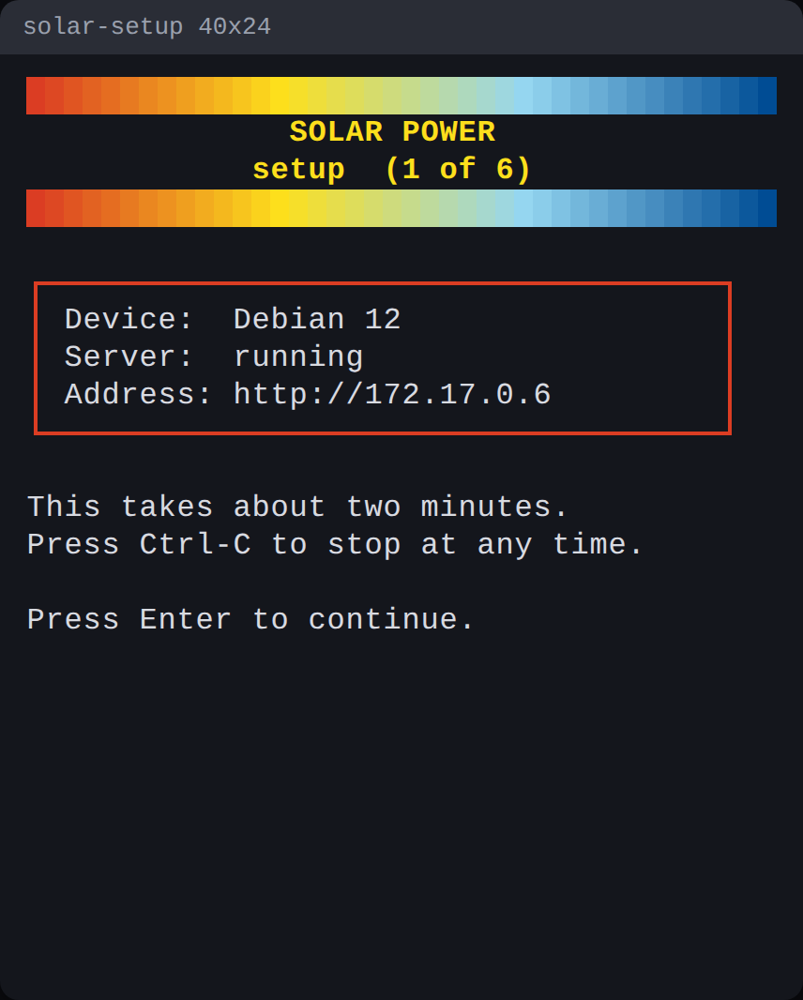
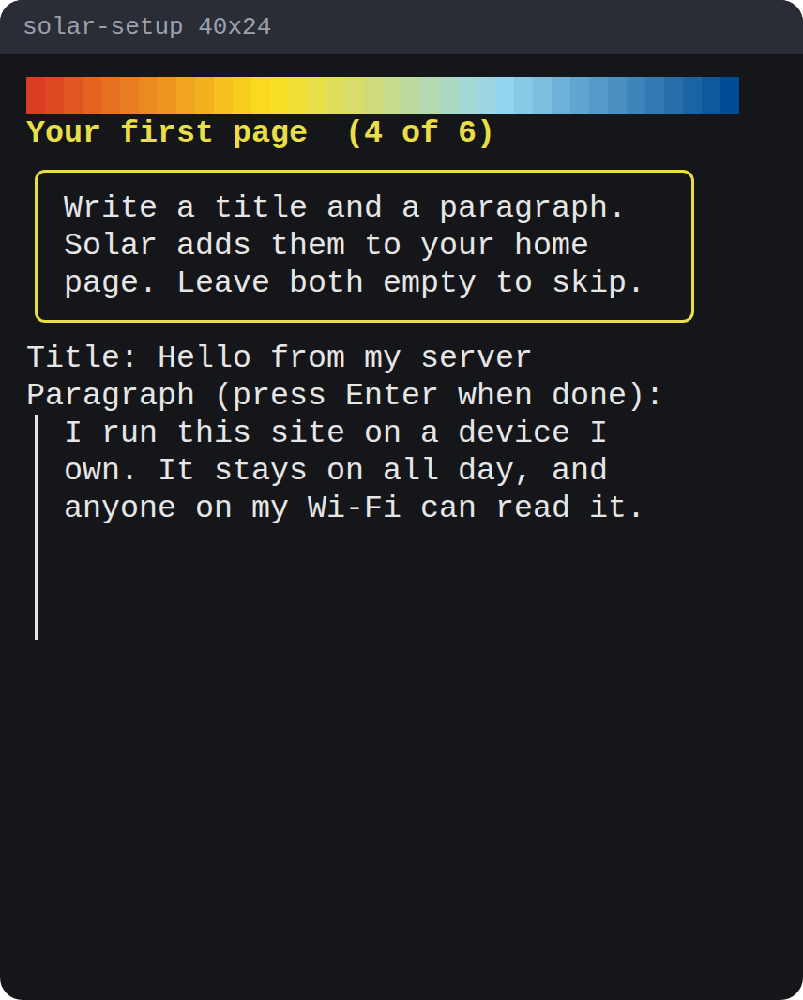
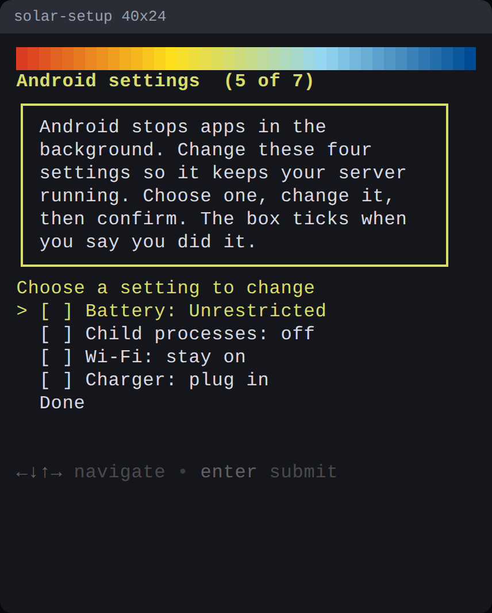
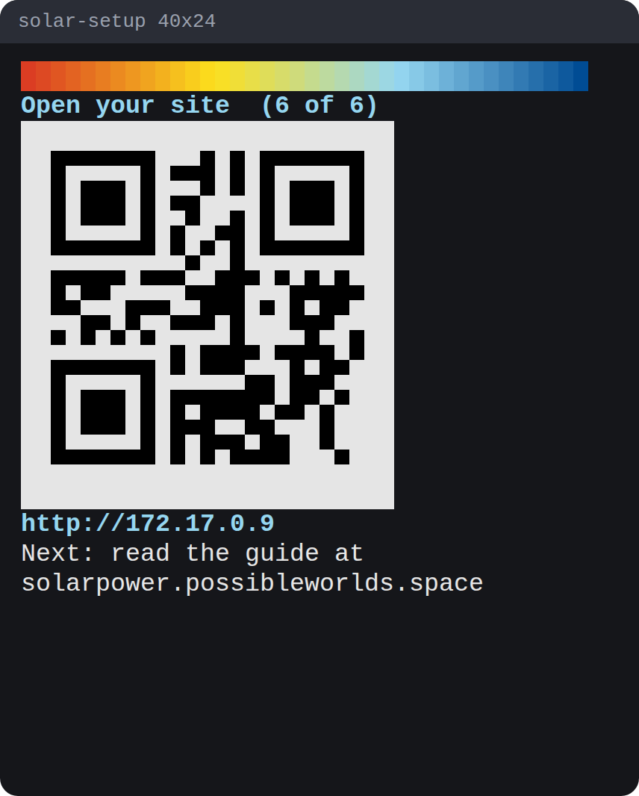

# Guided setup (`solar-setup`)

`solar-setup` asks a few questions, applies the answers and shows the address of your site. It takes about two minutes. The installer offers to start it when it finishes, and you can run it again whenever you like.

## Start it

- Debian and Raspberry Pi: `sudo solar-setup`. It needs root, because it writes to `/etc` and `/srv`.
- Termux: `solar-setup`.

The installer asks `Start it now? [Y/n]` at its end when it runs in a terminal. Answer `n` to skip, or run the installer with `--no-setup` to never ask. Under `curl ... | bash` the installer reads your answer from `/dev/tty`. When there is no terminal, it prints `Run solar-setup to finish` and stops.

## What it asks, and what each answer changes

| Screen | Answer | Where it goes |
| --- | --- | --- |
| Name your site | Site name | `site_name` in `solar.conf`, and the title and heading of `index.html` when they still hold the old name |
| Name your site (Debian and Pi) | Hostname | `hostname` in `solar.conf`. The installer applies it, so other devices find you at `<hostname>.local`. |
| Status page | Private or public | `status_public` in `solar.conf`. The installer writes the Caddyfile: private answers `403` to addresses outside your home network. |
| Your first page | Title and paragraph | A block in `index.html` between `<!-- solar-setup:begin -->` and `<!-- solar-setup:end -->`. Running again replaces only that block. Leave both empty to skip. |
| Android settings (Termux) | Four settings | Nothing is stored. Each item opens the matching Android screen and asks whether you did it. |

The settings are the ones the installer already reads (`install/install.sh --help` lists them). `solar-setup` writes them to `solar.conf` in `/etc/solar` (Termux: `$PREFIX/etc/solar`), keeps keys it does not ask about, and runs `install.sh --apply` to apply them. It never overwrites a page you edited, except for its own block and, when the old name is still there, the title and heading.

The screens are numbered, and the numbers count only the screens your device shows: five on Debian and the Pi (welcome, name, status page, first page, done), plus one for Android settings on Termux, plus one for the QR code when `qrencode` is installed. Plain mode uses the same numbers.

### Your first page

The paragraph box wraps long text, so nothing runs off a narrow screen. Press Enter when you finish. Press Ctrl-J to start a new paragraph on a new line: a blank line between two blocks makes two `
` elements. In plain mode the paragraph is one line.

### Android settings (Termux)

Choose a setting to change. `solar-setup` tells you what to change and opens that Android settings screen with `am start`, when Android has one. Change the setting by hand, come back, and answer `Did you change it?`. `solar-setup` cannot check the setting, so the box ticks (`[x]`) when you say you did it. Choose Done at any time, even with unticked boxes. The server runs without them, but Android may stop it in the background.

### Done, and the QR code

The first done screen lists your answers and the address. Press Enter, and a second screen shows the address as a QR code. Scan it with a phone on the same network. The screen needs the height of the code plus five rows (18 to 22 rows, depending on the address). A shorter window gets a message that lets you make it taller or skip.

## Run it again

Run `solar-setup` again. The name, hostname and status page start from your current answers. The first page starts empty: leave it empty to keep the block you wrote before, or write a new one to replace it. Press Enter on every screen to change nothing: a second run with the same answers leaves every file as it was.

## Plain mode and colour

- `solar-setup --plain` asks plain questions: no gum, no colour, no QR code. Answer by typing, or pipe the answers in, one line per question.
- Plain mode also starts by itself when stdin or stdout is not a terminal, when `TERM` is `dumb`, and when gum is missing.
- `NO_COLOR=1` turns colours off. The QR code stays black and white, because a phone cannot scan it otherwise.
- A terminal with fewer than 256 colours gets no colours: the rule is a line of `=` characters.

## Tools it uses

- `gum` draws the screens ([charmbracelet/gum](https://github.com/charmbracelet/gum), MIT). On Termux the installer installs it with `pkg`. On Debian and the Pi, `setup/install-gum.sh` downloads release v2.0.2 for amd64 or arm64, checks its SHA-256 against the value in the script, and only then installs it to `/usr/local/lib/solar/bin/gum`. `solar-setup` prefers that copy over one on `PATH`. A download with a different checksum is deleted and never run, and the setup asks plain questions instead.
- `qrencode` draws the QR code. The installer installs it with `apt` or `pkg`.

A failure to install either tool never fails the install.

## What is tested

| Check | Result |
| --- | --- |
| Plain mode with scripted answers, a second run that changes nothing, a 480-character paragraph, HTML escaping, the no-terminal and no-gum fallbacks, the checksum refusal and the installer hand-over (`tests/test-setup.sh`, a Debian 12 container on amd64 and arm64 in CI) | Passed |
| A gum run in tmux at 40 by 24 and the QR code decoded from the screen text (same test) | Passed |
| The screenshots on this page: tmux in a Debian 12 container, rendered to PNG, QR codes decoded from the PNG with `zbarimg` | Done. The Termux screenshots are a Debian container that pretends to be Termux, with a stand-in for `am`. |
| On a real Android phone: `pkg install gum qrencode`, the Android settings shortcuts, the address lookup, the phone keyboard | Not tested |
| On a real Raspberry Pi, or in the built image | Not tested |

## Troubleshooting

- **`Run this as root: sudo solar-setup`.** On Debian and the Pi, run it with `sudo`.
- **`Cannot find your site at ...`.** Run the installer first. It creates the site folder.
- **`The installer failed.`** The message shows the last lines of the installer log, in a file named `/tmp/solar-setup.XXXXXX.log`. With the Pi's read-only root on, turn it off first (see [hardening.md](hardening.md)).
- **`gum is not installed, so solar-setup asks plain questions.`** gum did not install, for example without internet access. Run the installer again, or use the plain questions: they change the same things.
- **The QR code is missing.** `qrencode` is not installed (`sudo apt install qrencode`, or `pkg install qrencode`), or you ran `--plain`.
- **The QR code does not scan.** Make the window tall enough that no row scrolls off, because a code with a cut border does not scan. On a phone, close the keyboard. If the address shows `<device address>`, the device has no network address yet.
- **On Termux, the address looks wrong.** `solar-setup` finds it the way the installer does: `ip`, then `termux-wifi-connectioninfo`, then `curl`. See [termux.md](termux.md).
