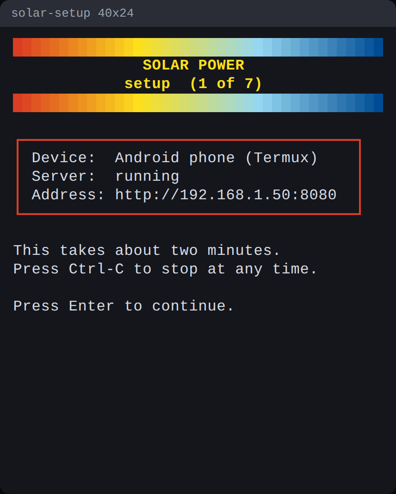
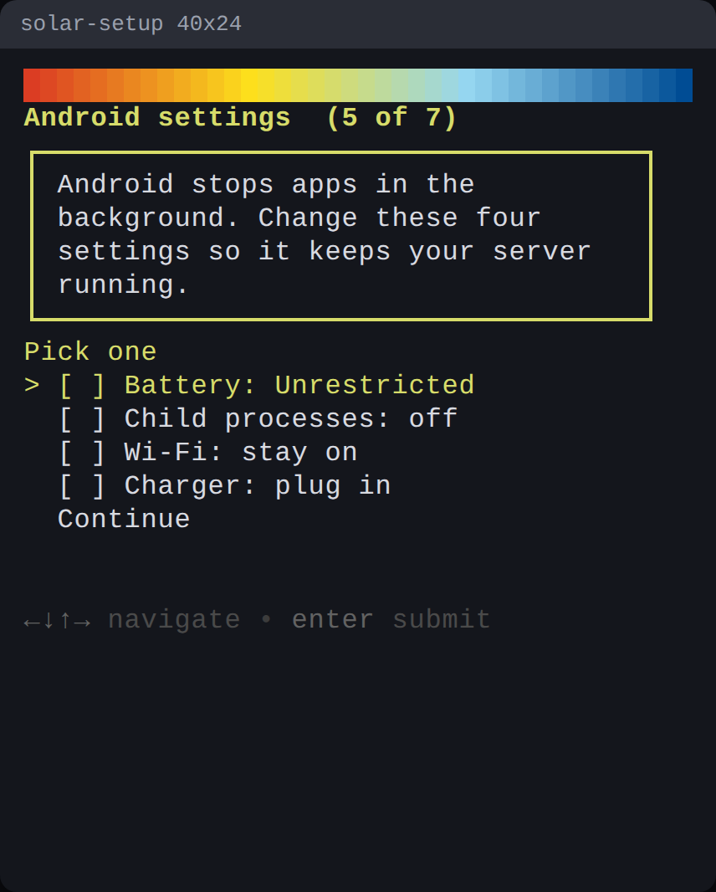
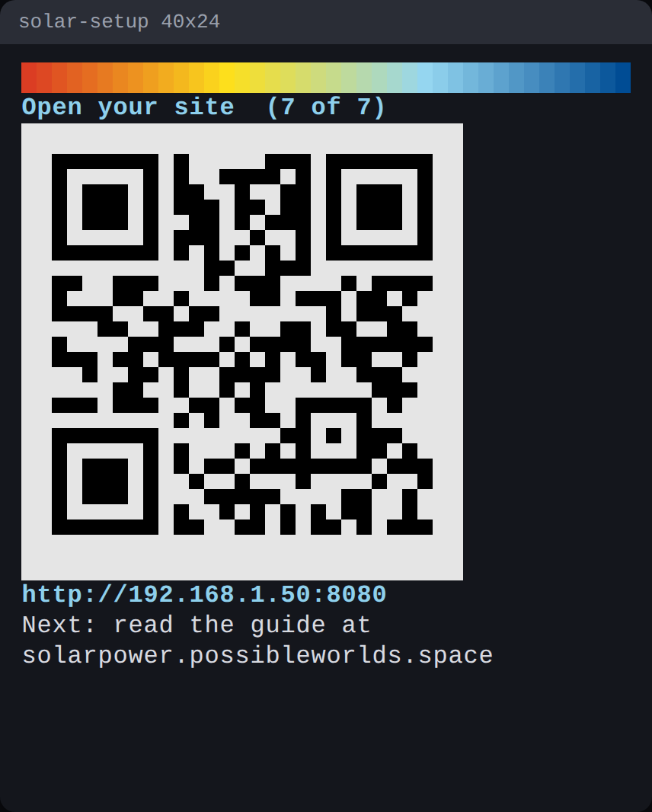

# Run a web server on an old Android phone (Termux)

Phones cannot take a flashable image, so the phone route is one pasted command in Termux. The server listens on port **8080**, because Android blocks apps without root from using ports below 1024.

## What you need

- An Android phone on Wi-Fi, ideally on its charger.
- [F-Droid](https://f-droid.org). Install Termux, Termux:Boot and Termux:API from F-Droid, not from the Google Play Store, which holds an outdated Termux.
- Open Termux:Boot once, and open Termux:API once. Android registers each app on its first launch.

## Install

Open Termux. First update every Termux package, because a half-updated Termux breaks `curl` (see Troubleshooting below). Use `apt` for this, not `pkg`: the `pkg` command calls `curl` itself, so it fails when `curl` is already broken.

```
apt update && apt full-upgrade -y
```

If Termux asks what to do about a config file, press Enter to accept the default. This can take a few minutes on an old install. If it reports that no mirror is selected, or cannot download packages, run `termux-change-repo`, choose a mirror group near you, and run the command again.

Then paste the install command:

```
curl -fsSL https://raw.githubusercontent.com/joshajh/solar-power-stack/main/install/install.sh | bash
```

The command downloads the newest installer from the `main` branch without a checksum or a pinned version, and it works only after the repository is public. To pin a version, set `SOLAR_SRC_URL` to the tarball of a release tag. This command has not run on a phone.

The script does this:

1. Updates the package list and installs Caddy and the Termux:API command-line tools with `pkg` (log: `~/solar-pkg.log`). It also tries to install `gum` and `qrencode` for the guided setup. If that fails, the install carries on and the setup asks plain questions.
2. Copies the starter site to `~/site` and never overwrites a page you edited.
3. Writes the Caddyfile (`$PREFIX/etc/caddy/Caddyfile`) for port 8080.
4. Writes `solar-serve` (`$PREFIX/bin/solar-serve`). It keeps the phone awake with `termux-wake-lock`, starts Caddy, restarts Caddy when it stops, and refreshes the status page every minute.
5. Writes `~/.termux/boot/solar-start.sh`, which starts `solar-serve` when the phone starts (Termux:Boot).
6. Reports which add-on apps it does not detect (Android 11 and newer can hide installed apps from Termux, so the report can be wrong) and opens Android's battery-optimisation settings.
7. Prints the address, for example `http://192.168.1.50:8080`. Open it from another device on the same Wi-Fi.

You can run the script again. It changes only what differs.

## Finish with the guided setup

The install output ends with:

```
Run solar-setup to finish. It asks a few questions and shows your address.
Start it now? [Y/n]
```

Press Enter to start the guided setup. If you answer `n`, or you run the installer without a terminal, run `solar-setup` later. It asks for the site name, who can open the status page and a first page, walks you through the Android settings below, and ends with your address as a QR code. [docs/setup.md](setup.md) lists every question and what it changes.







These screenshots come from a Debian container that pretends to be Termux, drawn at the phone's width of 40 columns. They have not been captured on a phone.

## Android settings

Do these once. Android otherwise stops Termux in the background. The guided setup walks you through the same four settings.

1. Open Settings, Apps, Termux, Battery and choose Unrestricted. The name differs between phones.
2. Do the same for Termux:Boot and Termux:API.
3. On Android 12 or newer, open Settings, Developer options and switch on **Disable child process restrictions** (the name differs between phones). Without it, Android can kill Caddy even with the wake lock and an unrestricted battery setting.
4. Leave the phone on its charger, with Wi-Fi on. Set "Keep Wi-Fi on during sleep" to Always if your phone has that option.

Phone testing may add settings to this list. If a setting on your phone matters and is missing here, open an issue.

## Status page

`http://<phone address>:8080/status` shows uptime, load, free disk space and, with Termux:API installed, battery percentage, charging state and battery temperature. By default only private addresses (your home network) can see it. See `status/README.md`.

## Troubleshooting

**`CANNOT LINK EXECUTABLE "curl": cannot locate symbol "SSL_set_quic_tls_early_data_enabled"`** (or another missing `SSL_` or `OPENSSL_` symbol). Termux is half-updated: `curl` or `libcurl` is newer than OpenSSL. This happens when one package is installed or upgraded on an old Termux without upgrading the rest. Fix it by updating everything with `apt`, not `pkg` (`pkg` calls `curl`, so it stops with "Failed to run the 'curl' command" while `curl` is broken; Termux's own message says to run `apt update && apt full-upgrade`):

```
apt update && apt full-upgrade -y
```

Then check that `curl --version` prints a version, and run the install command again. If `apt update` cannot download packages or says that no mirror is selected, run `termux-change-repo`, choose a mirror group near you, and run the command again.

## Test results

None of this has run on a phone yet. The installer logic runs in CI against a simulated Termux (`tests/test-termux.sh`: a fake `$PREFIX`, stub Termux commands, real Caddy). The simulation cannot show how Android treats the server.

| Check | Result |
| --- | --- |
| Tested phone model and Android version | Not tested yet. |
| One pasted command on a fresh Termux gives a server reachable from another device | Not run |
| `pkg install gum qrencode` works, and the guided setup runs on Termux | Not run. The setup runs in a Debian container that pretends to be Termux (`tests/test-setup.sh`). |
| Server survives a phone reboot (Termux:Boot) | Not run |
| Server survives 24 hours with the screen off | Not run |
| `am start -a android.settings.IGNORE_BATTERY_OPTIMIZATION_SETTINGS` opens the settings list | Not run |
| `pm list packages` reports Termux:Boot (else the script prints a reminder) | Not run |
| Termux:Boot starts `solar-serve` (the script sets `PATH` itself and uses Termux's bash for the status script) | Not run |
| Android 12 or newer kills Caddy without "Disable child process restrictions", and keeps it with the option on | Not run |
| The printed Wi-Fi address is right (`ip` or `ifconfig` on `wlan0`) | Not run |

## Behaviour that the script assumes from the Termux documentation

Each of these is unverified on a phone:

- `pkg install caddy` provides a working Caddy binary.
- `termux-wake-lock` keeps the CPU awake while Termux runs.
- Termux:Boot runs every executable script in `~/.termux/boot/` after the phone boots, and the script can start long-running processes.
- Caddy's admin address (`127.0.0.1:2019`) works inside Termux, and `curl` can reach it.
- `termux-battery-status` answers within 10 seconds when Termux:API is installed.
